# FirstSun · 融合 AI 助手的多端药店管理系统

FirstSun 是一个毕业设计项目，包含电脑顾客端、手机顾客端（H5 / 微信小程序）和药店管理端。顾客可以查商品、阅读说明书、提交处方申请或咨询门店。药店员工可以维护档案和库存、审核资料、处理订单，也可以让 AI 预填药品资料，核对后再提交审核。

[从零部署](docs/local-demo-install.md) · [演示账号](docs/local-demo-install.md#2-初始化空库) · [界面展示](#界面展示) · [开发文档](docs/README.md)

## 界面展示

### 电脑顾客端

**首页** · 顾客进入药店后，可从「开始选药」进入商品目录。

[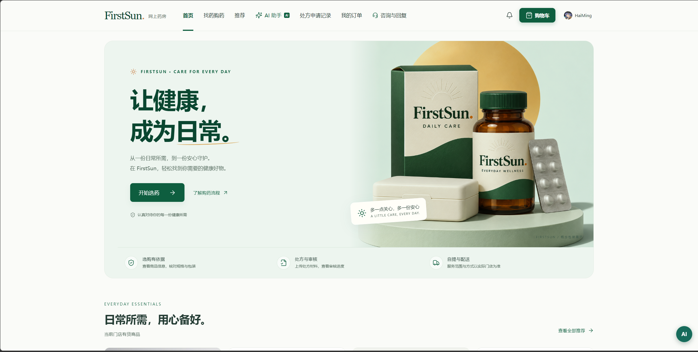](docs/images/readme/customer-storefront.png)

**找药购药** · 在当前门店搜索和筛选商品，直接查看包装、规格、售价和库存。

[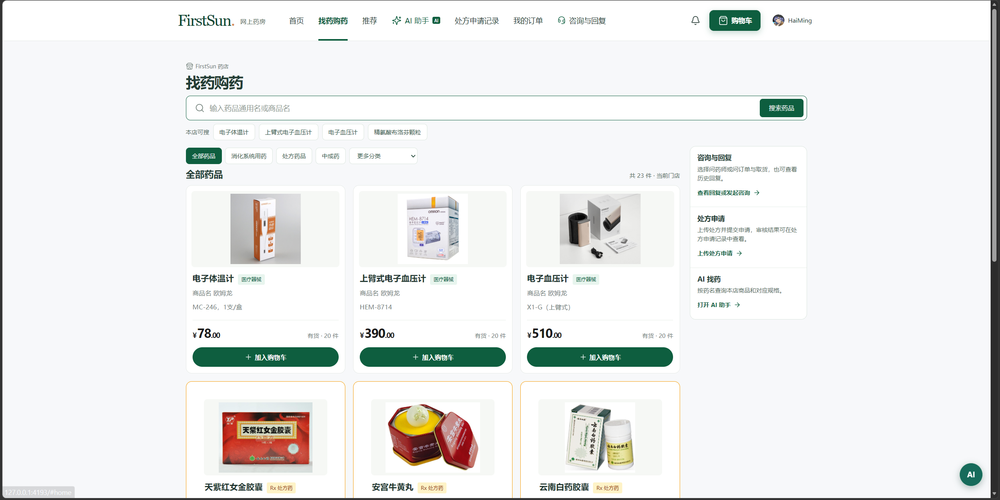](docs/images/readme/customer-product-list.png)

查看商品详情与说明书

[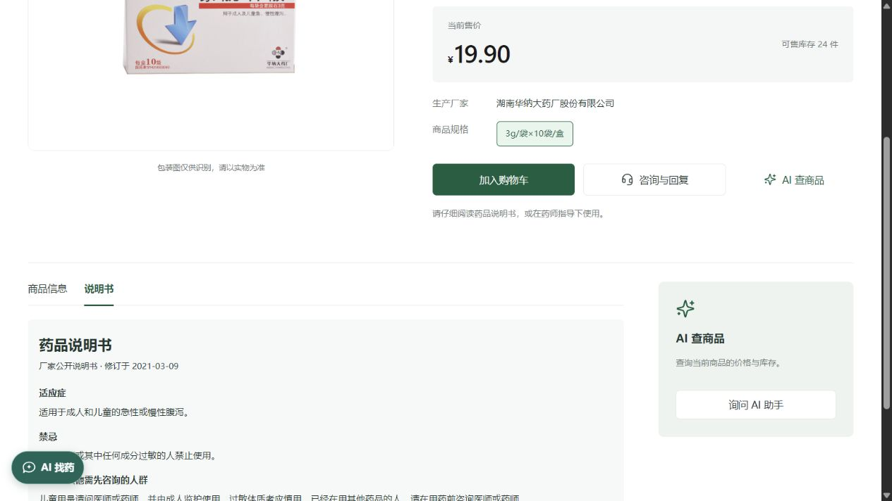](docs/images/readme/customer-product-leaflet.jpg)

### 手机顾客端（H5）

<table>
  <tr>
    <th>首页</th>
    <th>商品详情</th>
    <th>AI 查询商品</th>
  </tr>
  <tr>
    <td><a href="docs/images/readme/h5-home.jpg">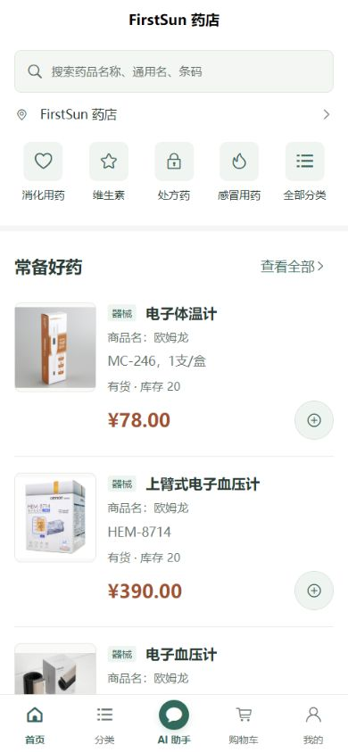</a></td>
    <td><a href="docs/images/readme/h5-product.jpg">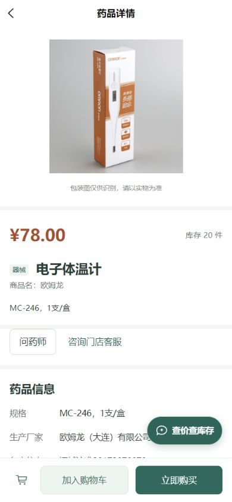</a></td>
    <td><a href="docs/images/readme/h5-ai-result.jpg">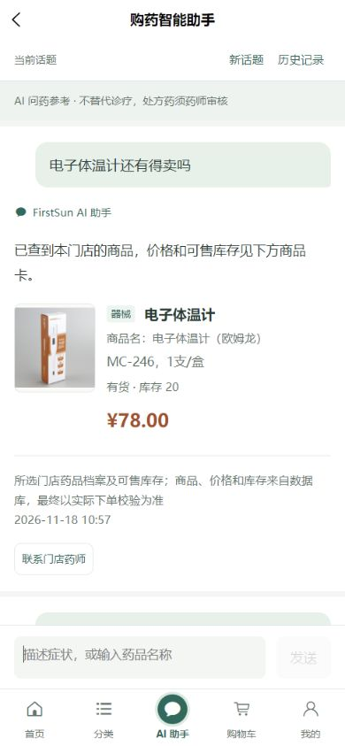</a></td>
  </tr>
</table>

### 药店管理端

**后台总览** · 员工登录后可查看药品、门店和员工概况，并从待办进入拣货、核销或药品审核。

[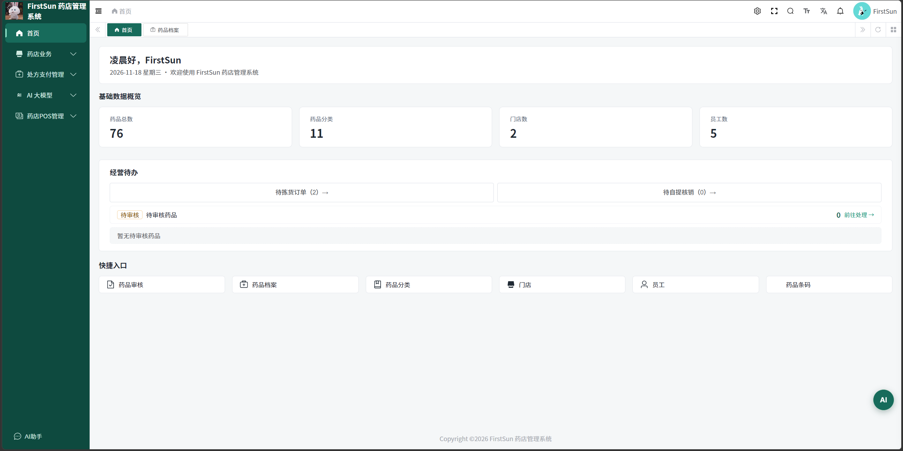](docs/images/readme/admin-overview.png)

**药品档案** · 查看商品包装、规格、启用状态与审核结果。

[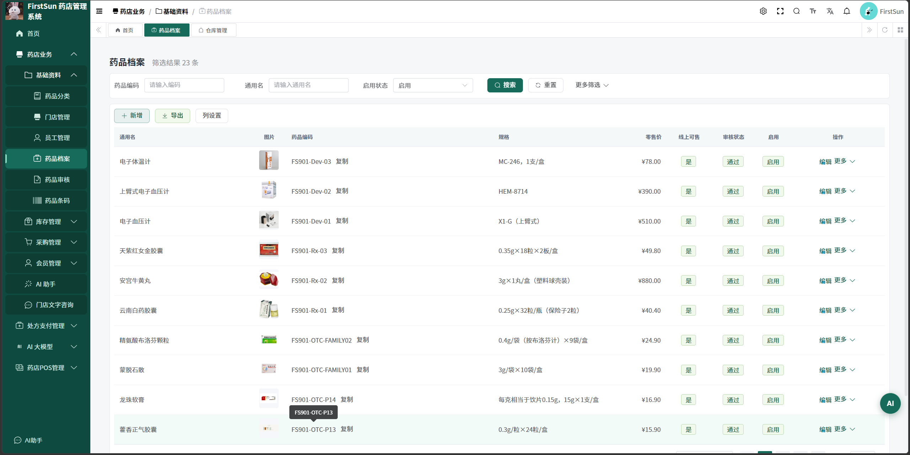](docs/images/readme/admin-drug-catalog.png)

查看 AI 新增药品与待审核流程

AI 新增药品使用同一条答辩演示资料。员工核对预填内容并提交后，档案进入待审核队列，由有权限的员工处理。

| 输入资料，AI 预填 | 核对属性，人工提交 |
| --- | --- |
| [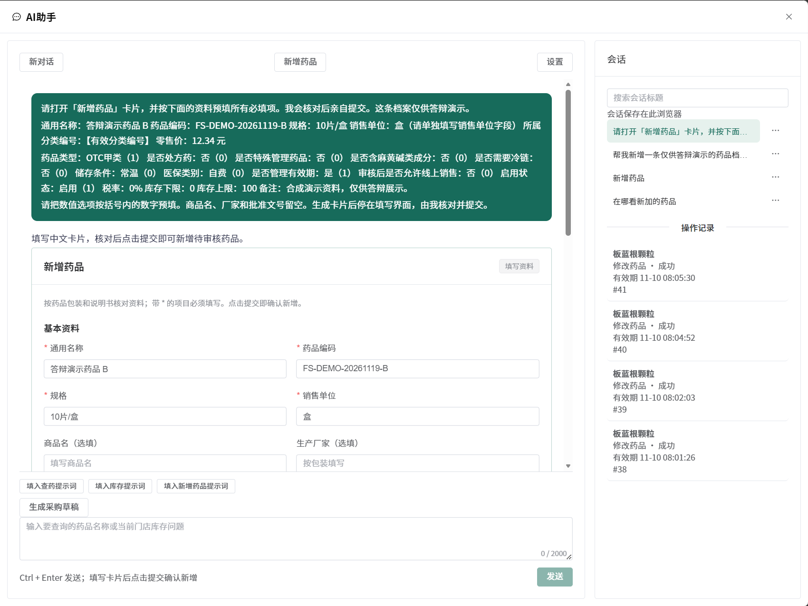](docs/images/readme/admin-ai-prefill.png) | [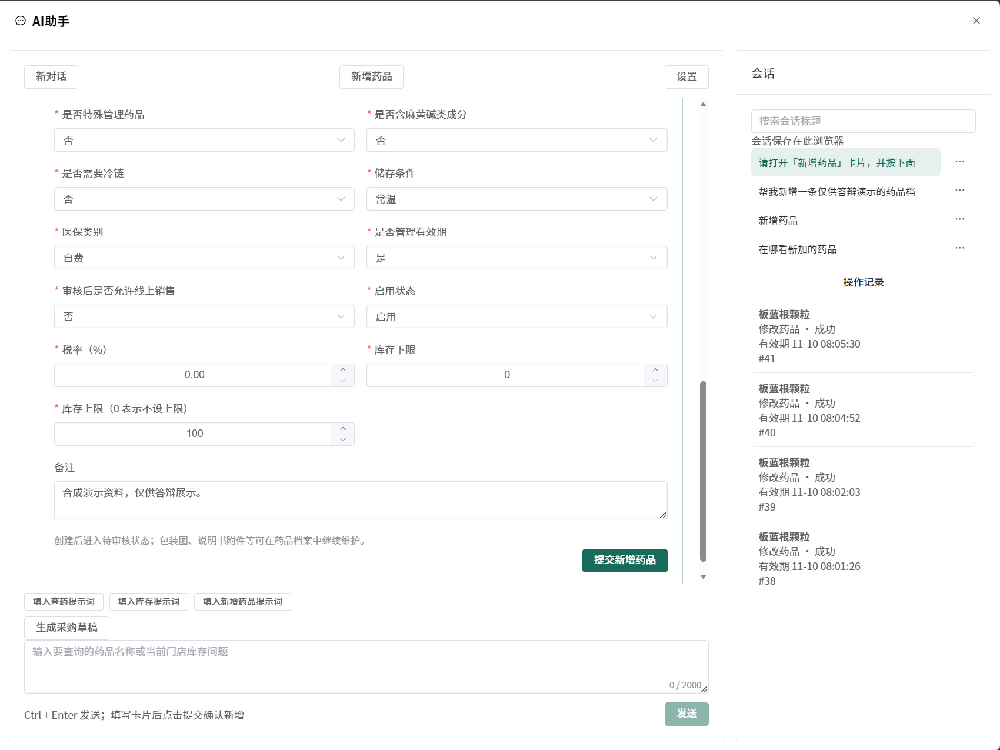](docs/images/readme/admin-ai-confirm.png) |
| **档案已创建** | **在审核队列查回记录** |
| [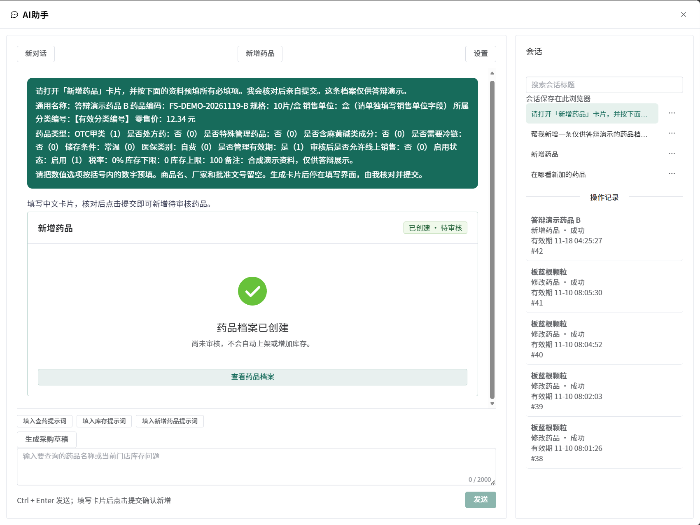](docs/images/readme/admin-ai-created.png) | [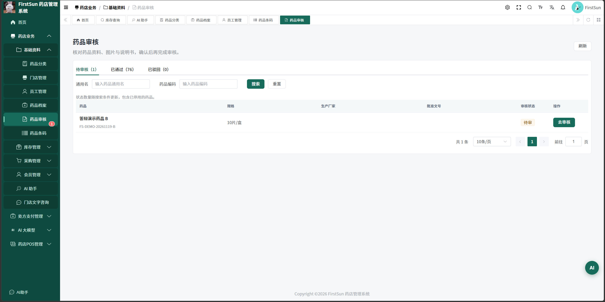](docs/images/readme/admin-drug-review.png) |

截图来自本机日常环境，门店库存和审核数量以采集时为准。

## 从零部署

1. 下载本仓库，在仓库根目录打开 PowerShell 7。准备 Docker Compose 和 Node.js **22.13.0 或以上**。
2. 按[从零搭建本机演示环境](docs/local-demo-install.md)复制本机配置、初始化空库并构建服务。初始化器会导入 **23 款商品及其包装图**，其中有 17 款非处方药、3 款处方药和 3 款医疗器械，也会创建演示账号和合成订单、咨询、处方记录。
3. 打开顾客端或管理端，按部署文档的账号表登录。若要体验 H5 或 AI 说明书检索，按同一文档启动 H5 或配置可选的 RAG 索引。

| 界面 | 首次部署的默认地址 |
| --- | --- |
| 电脑顾客端 | <http://127.0.0.1:5193> |
| 药店管理端 | <http://127.0.0.1:38081> |
| 手机 H5 | <http://127.0.0.1:4189>（按部署指南单独启动） |

已有日常环境按 [README.local.md](README.local.md)启动。演示目录和包装图随仓库交付，门店库存为初始化时的演示库存。处方药保留审核规则。[包装图来源](deploy/demo-assets/catalog/image-sources.md)

## 功能与技术

| 模块 | 功能 | 技术 |
| --- | --- | --- |
| 电脑顾客端 | 搜索、商品详情、购物车、订单、处方申请、邮箱会员登录和门店咨询 | Vue 3、Vite、Nginx |
| 手机顾客端 | H5 购物、邮箱注册与登录、找回密码、个人资料；提供微信小程序构建 | uni-app、Vue 3、Pinia |
| 药店管理端 | 药品档案与审核、门店库存、采购收货、处方审核、线上订单与 POS | Vue 3、TypeScript、Element Plus |
| AI 助手 | 顾客端查询门店商品和说明书依据；管理端查询库存、预填药品资料和生成采购草稿 | Spring AI、SSE、Qdrant、本地向量化服务 |
| 后端与部署 | 统一租户、会员、权限和业务接口 | Java 17、Spring Boot 3、MyBatis Plus、MySQL 8、Redis 7、Docker Compose |

支付采用本机模拟流程。微信小程序已提供构建入口，真机登录和当前版本的完整业务验收仍待验证。AI 用于商品与资料查询，处方由药师审核。

## 项目来源

毕设题目为《融合 AI 助手的多端药店管理系统设计与实现》。项目基于 yudao / RuoYi-Vue-Pro、yudao-ui-admin-vue3 与芋道商城 uni-app 二次开发。前期团队项目提供药品、库存、采购、POS、处方和会员等业务基础。个人毕设在此基础上完成电脑顾客端和顾客 AI、说明书 RAG、邮箱会员认证、私有处方材料、门店文字咨询及统一部署入口。

## 开发文档

- [本机日常环境](README.local.md) · [数据库初始化](docs/database-init-paths.md) · [可选 RAG 配置](docs/local-demo-install.md#可选-rag-配置)
- [文档导航](docs/README.md) · [项目交接](HANDOFF.md) · [历史验收报告](docs/acceptance/reports/)
- [顾客 AI](docs/customer-ai-development.md) · [处方与通知](docs/prescription-business-development.md) · [门店咨询](docs/store-consultation-development.md)

上游许可与版权声明保留在 [后端](backend/LICENSE)、[管理端](admin-ui/LICENSE) 和 [uni-app 顾客端](mall-uniapp/LICENSE)。
